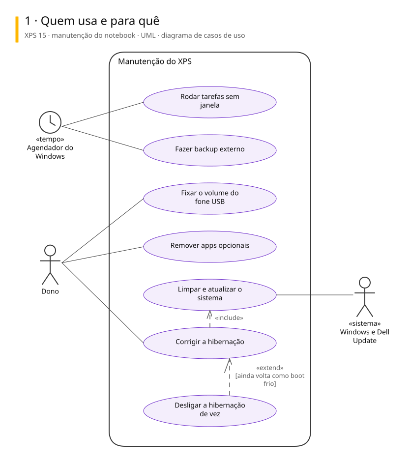
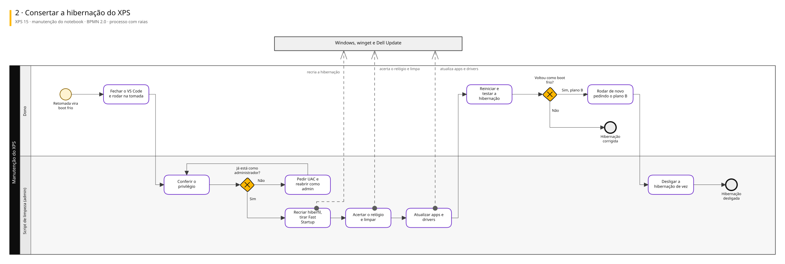
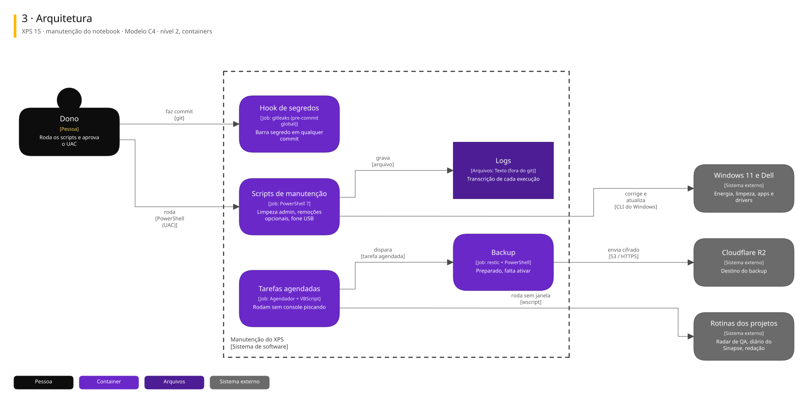

# Arquitetura

Três vistas do sistema, cada uma numa notação padrão.

| Vista | Notação | Responde |
|---|---|---|
| Casos de uso | UML | Quem usa e para quê |
| Processo | BPMN 2.0 | Como o trabalho anda, com uma raia para cada quem executa |
| Arquitetura | C4, nível 2 | De que partes o sistema é feito e com quem conversa |

## XPS 15 · manutenção do notebook

Registro e manutenção do Dell XPS 15 9510: scripts PowerShell que corrigem hibernação, relógio e limpeza, tarefas agendadas sem janela piscando, hook de segredos e backup externo preparado. O script de administrador está revisto, mas ainda não rodou.

### Quem usa e para quê

### Consertar a hibernação do XPS

### Arquitetura

Para editar: [xps-15.excalidraw](./xps-15.excalidraw), que abre em [excalidraw.com](https://excalidraw.com) ou na extensão Excalidraw do VS Code.

## De onde vêm

Os diagramas são gerados a partir do Sinapse, o vault onde o Pedro organiza notas e projetos. Mudança feita direto aqui some na próxima publicação: o lugar de mudar é a especificação no Sinapse.
